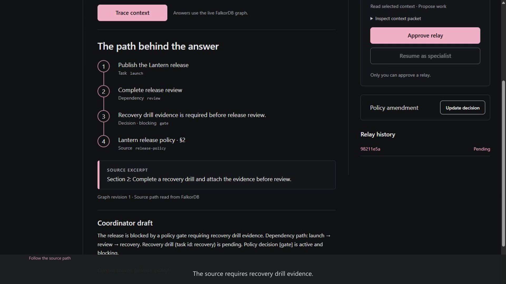

# Agent Office — Source-linked Relays

Graph Hacks 2026 · v0.2.1 · working local prototype

A local agent traces task dependencies, decisions and sources in FalkorDB, then
prepares a scoped relay for human approval. A specialist resumes from the approved
packet in a fresh session. Changed policies invalidate outdated context.



Tracks: **Agent Memory and Coordination**, **Company Brain**.
[Watch the working demo](https://blackstackdev.github.io/agent-office-relay/) ·
[Download MP4](docs/demo.mp4) · [Demo details](docs/DEMO.md)

## Local setup (tested Windows)

Prerequisites: Python 3.11+, Node 22.17.1 or compatible, Docker Desktop Linux engine,
and Ollama running. The tested machine has an RTX 3060 12 GB and 64 GB RAM; this is
the observed test configuration, not a minimum-hardware guarantee. Other systems
have not been verified. First setup downloads the database image, model and packages.

From this repository directory in PowerShell:

```powershell
python -m venv .venv
.\.venv\Scripts\python.exe -m pip install -r requirements.txt
ollama pull qwen3:4b-instruct
docker compose up -d --wait
Push-Location web
npm ci
npm run build
Pop-Location
.\.venv\Scripts\python.exe src\server.py
```

Open http://127.0.0.1:4176. Ctrl+C stops the app; `docker compose stop` stops only
the graph service while retaining its volume. Restart with `docker compose up -d --wait`.
No account or model API key is required. Inference is configured only against local
Ollama; setup still needs Internet downloads. Model tag tested: qwen3:4b-instruct,
manifest prefix 0edcdef34593. The FalkorDB image is pinned by digest in compose.yaml.

## Demonstration

1. Trace the prefilled release question. Inspect the graph path and policy excerpt.
2. Review the pending packet, then explicitly approve the relay.
3. Resume as the specialist and inspect its fresh-session verification plan.
4. Save the prefilled policy amendment. The old packet becomes outdated.
5. Trace again: the new source is cited while incomplete task statuses remain visible.
6. Reload the app: source versions, relay history and the latest coordinator draft persist.

All data is fictional. Human approval in the supplied demonstration is a scripted
QA action on that fixture, not a real operational release authorization.

## Graph and architecture

[Graph model](docs/GRAPH-MODEL.md) · [Exact Cypher catalog](docs/queries.cypher) ·
[Architecture and limits](docs/ARCHITECTURE.md) · [AI assistance](AI-DISCLOSURE.md)

FalkorDB stores the relationships, sources, project revision, relay snapshots,
approval state and agent runs. Without it the workflow fails; there is no substitute
database or canned-answer path. The model receives bounded tools, not arbitrary Cypher.
Structured source IDs are validated against current graph records before display.

## Checks

```powershell
.\.venv\Scripts\python.exe -m unittest discover -s tests -v
.\.venv\Scripts\python.exe tests\live_model_check.py
.\.venv\Scripts\python.exe tests\restart_check.py
.\.venv\Scripts\python.exe tests\http_check.py
```

Start the graph before checks; the HTTP check also needs the app running. Integration
and model checks use isolated `relay_test_<hex>` graphs and remove only their own
fixture. The restart check briefly restarts this project's graph container.

Observed: 24 automated checks, actual local model workflow, database restart,
five local HTTP checks, production frontend build and recorded browser workflow.
The included older fresh-dependency evidence is a clean install/build on the same
Windows host with Docker/Ollama already installed, not fresh-machine certification.

## Limits

One fictional project; eight-hop traversal cap; one local model in two role sessions.
No independent workers, arbitrary code execution, task completion or release automation.
Generated summaries/plans remain drafts. Source validation is not semantic truth proof.
Only trusted local use: role IDs and approval flags are not remote authentication.
Direct graph administration bypasses app revision tracking. No tenant-security,
backup/restore, production-deployment or independent security-audit claim is made.

No additional open-source license is granted for the original project code. Third-party tools retain their own licenses and are downloaded
separately. See [dependency notices](DEPENDENCIES.md).

Product direction: Raiden. Implementation/technical QA: Codi, with AI assistance.
A Krēˈādiv Worx experiment. Main implementation and current UI began 15 October 2026.
