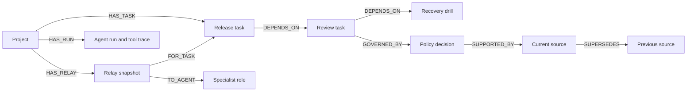

# Graph data model

Project(id, revision) owns Task nodes. Task stores id, name and recorded status.
Decision stores text, state and version; Document stores source id/title/URI/excerpt.
Agent is a fixture role. Relay stores immutable context/packet JSON, context hash,
captured revision, creation time and approval status. AgentRun stores the model,
question, draft, tool trace, revision and creation time.

Task -> ASSIGNED_TO -> Agent also records role ownership. Sources are synthetic
fixture:// documents, not external web resources or private operational files.

Context traversal follows DEPENDS_ON paths from zero to eight hops, then joins
GOVERNED_BY and SUPPORTED_BY. Actual record ID paths are returned with source
excerpts. The source path shown beside the answer is database-derived.

A policy amendment creates a new Document, links SUPERSEDES to the old Document,
replaces the decision's current SUPPORTED_BY link, increments decision version
and project revision. Old relay snapshots remain unchanged for audit.

Approval requires pending status and the same project/relay revision in a single
write query. Consumption requires approval, matching revision and selected recipient.
Clearing a decision does not mark any Task complete. See queries.cypher for the
exact implementation queries, extracted without rewriting from source.
